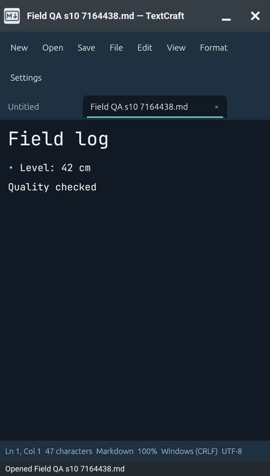
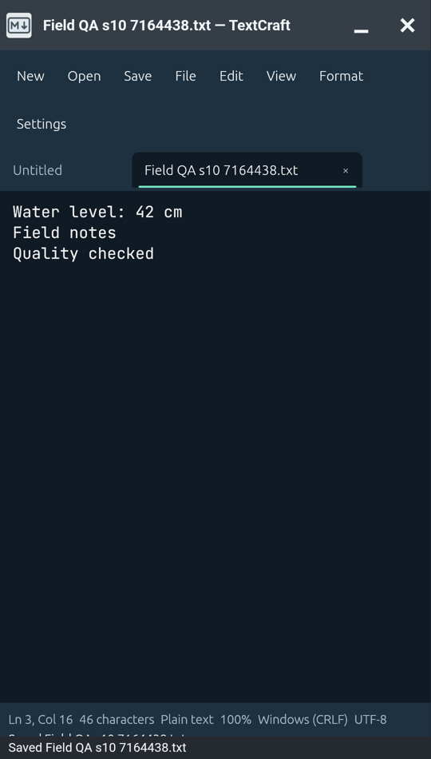

# TextCraft on WebOS

Open **Office → TextCraft**. Use My files to save documents across sign-ins. Guest edits are temporary within the current page session. [Browser build and Files integration](../webos.md)

## Phone workflow

1. Tap the first editor line and enter a two-line field note. Choose **Save**, cancel the folder picker, and retry. Choose **Documents** and enter a bare name. The suggestion is `Untitled.txt` and the saved file gets the `.txt` extension.
2. Choose **File → New Markdown tab**. Enter a heading and a bold list item. Save with the `.md` extension. Use **View → Markdown → Formatted view** to see the heading and list. Use **Source view** for editing.
3. Sign in again in a fresh browser session. Select each document in My files and choose **Open With → TextCraft**. Append a line and save to the same path. Both files retain their contents and format.
4. Open a UTF-16 LE sample with a byte-order mark and CRLF line endings. Add a line and save. Compare the saved bytes with the expected Unicode text, byte-order mark and line endings.

The Galaxy S10+ used Chrome 158.0.8127.92 at 411 CSS pixels. The software keyboard opened during editing. Chromium at 820 and 1300 CSS pixels repeated both save and reopen paths and preserved the UTF-16 sample. The WebOS status stays within the window and shows the actual save or open result.

## Coverage and release

The phone workflow covers editing, Markdown presentation, native Files storage and encoding. Search and replace, settings, desktop session recovery and printing have separate coverage in the feature matrix. [Feature matrix](../feature-matrix.md#webos-browser-verification)

Viewer `e91a7ae19ef02da5c0eb6157e928b6bb838c8da1d575f7f895a7936a63141129` uses this editor at `aee7b371daa2320d7026d1216c7c50a06ddaf1b9` and Desktop adapter `d1f42595d662e0e845dd9a8e1ade2423034c6685`. [WebOS release and rollback](https://github.com/CC-David-CC/WebOS/blob/webos/textcraft-phone-files/deploy/TEXTCRAFT-PHONE-FILES.md)
